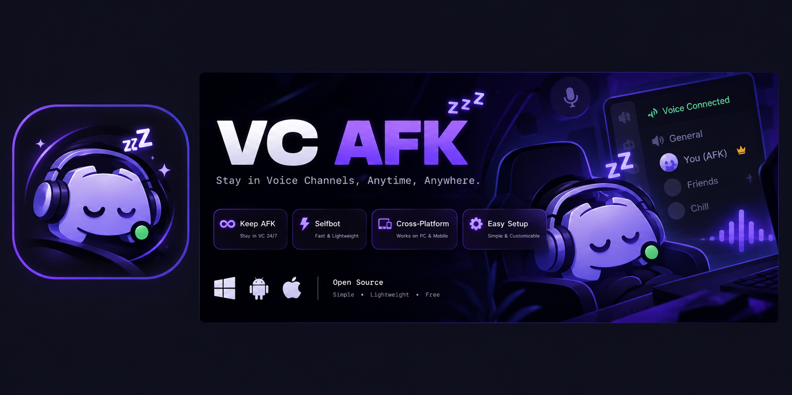
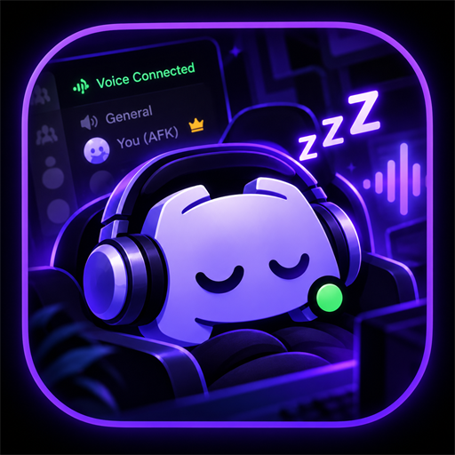

<div align="center">
  

  # VC AFK &middot; 24/7 Voice Channel Selfbot

  <p><b>Stay connected in Discord Voice Channels 24/7 directly from your Android phone or PC. Zero hosting fees, zero external servers, 100% client-side privacy.</b></p>

  <p>
    <a href="https://github.com/farxru/vc-afk-selfbot/releases"></a>
    
    
    
  </p>
</div>

---

## 🌟 Why VC AFK?

Most Discord 24/7 bots require you to pay monthly for a VPS, keep a power-hungry PC running all night, or upload your private token to untrusted third-party cloud hosting services.

**VC AFK solves this completely:** It transforms your **Android phone into a dedicated 24/7 Discord host** using a lightweight, battery-efficient Android Foreground Service.

### Key Highlights

* 📱 **Host Directly on Your Phone (0$ Hosting Cost)**: No VPS, no cloud bills, no Termux commands. The native Android APK runs 24/7 in the background with your screen locked.
* 🛡️ **100% Private & Fully Secured**: Your Discord token is stored **locally on your device** inside private Android storage (`SharedPreferences`). It is never transmitted to any third-party server, proxy, or webhook.
* 🔄 **Instant Auto-Rejoin on Kick**: If a server moderator or administrator disconnects or kicks your account from the voice channel, the bot automatically rejoins your target VC within **1 second**.
* ⚡ **Main Discord App Coexistence**: When you connect, move, or disconnect on your official Discord desktop or mobile app, the bot detects the shift and automatically pulls your 24/7 session right back into your target voice channel.
* 🔋 **Ultra Battery-Friendly**: Runs on raw, event-driven Discord Gateway WebSockets. Consumes **< 15MB RAM** and negligible battery (< 1% over 24 hours).
* 📡 **Continuous Presence Watchdog**: A background watchdog verifies presence every 15 seconds. If Wi-Fi blips or mobile data drops, connection is re-established seamlessly.
* 🎥 **Virtual Screenshare & Camera**: Start blank streams (`.ss` / `.ssoff`) and webcam simulator (`.cam` / `.camoff`) without any video rendering overhead.
* 🖥️ **Cross-Platform**: Run as a native Android app, a Windows background tray app, or a lightweight Node.js script on Linux / macOS.

---

## 📱 Method 1: Android Phone (Host 24/7 On Your Phone)

Run the bot natively on your phone without needing your PC on.

<div align="center">
  
</div>

### 1. Download & Install the APK
* Go to the [**Releases Page**](https://github.com/farxru/vc-afk-selfbot/releases) and download **`DiscordVCBot.apk`**.
* Tap the file to install *(allow "Install from Unknown Sources" if prompted)*.
* *Note: The APK is signed with an official release signature and passes Android security checks and Google Play Protect.*

### 2. Disable Android Battery Optimization (Important)
Android devices put background apps to sleep after 5–10 minutes unless granted background permission:
1. Open your phone's **Settings** ⚙️ ➔ **Apps** ➔ **VC AFK Bot**.
2. Tap **Battery** (or "App Battery Usage") and set it to **"Unrestricted"** (or *"Don't optimize"* / *"No restrictions"*).
3. *(Samsung)*: Settings ➔ Battery ➔ Background usage limits ➔ Add **VC AFK Bot** to **"Never sleeping apps"**.
4. *(Xiaomi / Redmi / POCO)*: Enable **"Autostart"** and set Battery Saver to **"No restrictions"**.

### 3. Start 24/7 Hosting
1. Launch **VC AFK Bot** on your phone.
2. Enter your **Account Token** and your **Discord User ID**. *(Saved privately on your device)*.
3. Enter your **Target Voice Channel ID** *(e.g. `123456789012345678`)*.
4. Tap **START 24/7 BOT (BACKGROUND)**.
5. A persistent notification appears in your status bar:
   > **VC AFK Bot 24/7** &middot; *🟢 In VC: #channel-name*
6. **You're done!** Turn off your phone screen, lock your phone, or open other apps. Your bot will remain in the voice channel 24/7.

---

## 💻 Method 2: Windows Background Mode (PC)

If you prefer running on your PC, VC AFK includes a clean Windows tray launcher:

1. Clone or download this repository:
   ```bash
   git clone https://github.com/farxru/vc-afk-selfbot.git
   cd vc-afk-selfbot
   ```
2. Install dependencies:
   ```bash
   npm install
   ```
3. Edit [`config.json`](config.json) with your credentials:
   ```json
   {
     "token": "YOUR_DISCORD_USER_TOKEN",
     "ownerId": "YOUR_DISCORD_USER_ID",
     "prefix": ".",
     "selfDeaf": true,
     "selfMute": false,
     "dashboardPort": 3000
   }
   ```
4. Double-click **[`start.bat`](start.bat)**:
   * The bot launches silently into your **Windows System Tray** (near your clock).
   * Right-click the tray icon to check status, view real-time logs, open the mobile web dashboard, or stop the bot.
   * To stop anytime, right-click the tray icon and select **Stop & Exit**, or run **[`stop.bat`](stop.bat)**.

### Mobile Web Dashboard (PWA)
When running on PC, open `http://localhost:3000` (or `http://<your-pc-ip>:3000` from your phone) to access the real-time web controller with "Add to Home Screen" support.

---

## ⌨️ Command Reference (Owner-Only)

All commands are strictly restricted to your Discord user ID. Commands from other users are completely ignored.

| Command | Action | Description |
|---|---|---|
| **`.jvc <channel_id>`** | Join Voice Channel | Joins the target VC and enforces 24/7 persistence. |
| **`.lvc`** | Leave Voice Channel | Cleanly disconnects and terminates any active stream or camera. |
| **`.mute`** | Mute | Self-mutes your account in the voice channel. |
| **`.unmute`** | Unmute | Unmutes your account in the voice channel. |
| **`.deaf`** / **`.deafen`** | Deafen | Self-deafens your account in the voice channel. |
| **`.undeaf`** / **`.undeafen`** | Undeafen | Undeafens your account in the voice channel. |
| **`.cam`** | Camera ON | Activates the camera simulator in VC. |
| **`.camoff`** | Camera OFF | Deactivates the camera in VC. |
| **`.ss`** | Screenshare ON | Starts a blank Go Live screenshare stream. |
| **`.ssoff`** | Screenshare OFF | Stops the screenshare without leaving the VC. |

---

## 🔒 Security & Privacy Architecture

Security and account safety are our top priorities:

| Principle | How VC AFK Delivers |
|---|---|
| **Zero Remote Servers** | There is **no backend server**, no tracking database, and no intermediate proxy. All connections go directly from your device to Discord (`wss://gateway.discord.gg`). |
| **Local Private Storage** | Tokens entered in the Android app are stored exclusively in your device's private `SharedPreferences` (`MODE_PRIVATE`). |
| **Encrypted Communication** | Uses strictly encrypted TLS WebSockets (v9) and HTTPS REST API endpoints. Cleartext HTTP is disabled. |
| **Audited Android Permissions** | Only requests essential permissions required for foreground background service operation (`INTERNET`, `WAKE_LOCK`, `FOREGROUND_SERVICE`, `POST_NOTIFICATIONS`). No contacts, camera, microphone, or storage snooping. |
| **Release Signing** | Built with standard Android 14 (API 34) guidelines, signed with cryptographic V1 & V2 APK schemes, and compliant with Google Play Protect. |

---

## 🛠️ Build Your Own APK (1-Click Automated Cloud Build)

Want to compile the APK yourself from source code?

1. Double-click **[`build_apk_github.bat`](build_apk_github.bat)**.
2. Enter your GitHub repository URL (or press Enter for default).
3. GitHub Actions will compile a fresh, signed **Release APK** in ~60 seconds.
4. Download the compiled `.apk` directly from your repository's **Actions** or **Releases** tab.

*For detailed build documentation, see [BUILD_MY_APK.md](BUILD_MY_APK.md).*

---

## 📄 License

Distributed under the **MIT License**. See `LICENSE` for more information.

<div align="center">
  <sub>Built with ❤️ for 24/7 Discord uptime. Free, lightweight, and open source.</sub>
</div>
